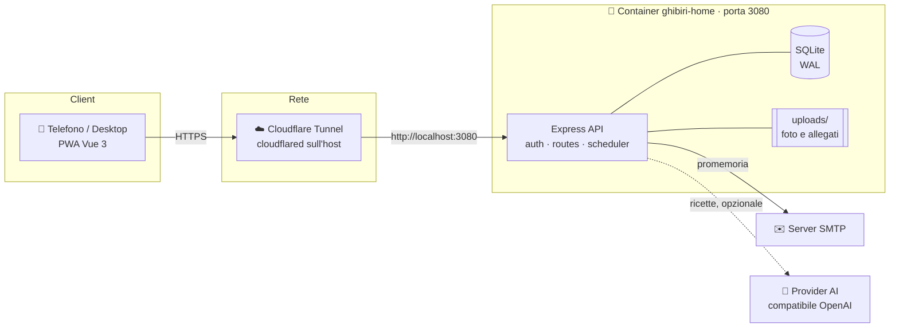
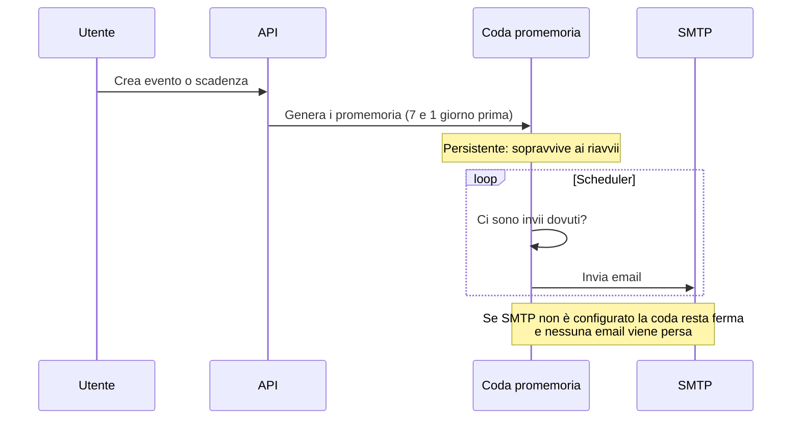

<div align="center">


# 🏡 Ghibiri Home

### La casa di famiglia, organizzata.

Calendario, spesa, scadenze, ricette e piante in un posto solo.<br/>
Privato, self-hosted e pensato per il telefono.

<br/>


[**Avvio rapido**](#-avvio-rapido) · [**Funzionalità**](#-cosa-cè-dentro) · [**Architettura**](#️-architettura) · [**Configurazione**](#️-configurazione) · [**Sicurezza**](#-famiglia-privacy-e-sicurezza)

</div>

---

## ✨ In breve

**Ghibiri Home** è un servizio web self-hosted che raccoglie in un'unica app la vita pratica di una famiglia: cosa c'è da comprare, cosa scade, cosa c'è in calendario, cosa si cucina, quali piante vanno annaffiate.

Nasce per **mamma.gabrielepili.it**, ma è un normale progetto Docker che puoi far girare dove vuoi. È pensato per stare su un piccolo server (una Radxa con 2 GB di RAM) dietro un Cloudflare Tunnel, senza servizi esterni obbligatori.

> [!TIP]
> **Nessun account, nessuna password da ricordare.** Ogni membro della famiglia entra con un **PIN di 4 cifre**. La sicurezza arriva da HTTPS, blocco dopo 5 tentativi, sessioni `HttpOnly` e rate limiting.

<table>
<tr>
<td align="center">📱<br/><b>Mobile-first</b><br/>Installabile come PWA su Android e iOS</td>
<td align="center">🪶<br/><b>Leggero</b><br/>Un container, circa 40 MB di RAM per il database</td>
<td align="center">🔒<br/><b>Privato</b><br/>Nessuna analytics, nessun CDN, nessun font remoto</td>
<td align="center">🇮🇹<br/><b>In italiano</b><br/>Interfaccia interamente italiana</td>
</tr>
</table>

---

## 🖼️ Screenshots

> [!NOTE]
> **TODO:** aggiungi qui le schermate reali dell'app, ad esempio in `docs/assets/`. Sezioni consigliate: *Oggi*, *Spesa*, *Calendario*, *Ricette*, *Piante*.

<!--
<div align="center">


</div>
-->

---

## 🧩 Cosa c'è dentro

| | Area | Cosa puoi fare |
|---|---|---|
| 🌤️ | **Oggi** | Riepilogo della giornata: appuntamenti, scadenze vicine, spesa e piante da curare. Aggiunta rapida alla spesa. |
| 🛒 | **Spesa** | Più liste (casa, festa, mare), reparti, quantità, spunta, pulizia dei completati. Un prodotto già presente non viene duplicato. |
| 📅 | **Calendario** | Vista mensile, eventi con ora, luogo e categoria, ricorrenze (giorno, settimana, mese, anno), promemoria email. |
| 🧾 | **Scadenze** | Bollette, documenti, veicoli, casa. Importo, note, ricorrenza mensile o annuale, "fatto" con avanzamento automatico. |
| 🍳 | **Ricette** | Ingredienti, porzioni, tempo, procedimento a step, foto, preferiti, **"aggiungi ingredienti alla spesa"** e **generazione con AI**. |
| 🪴 | **Piante** | Schede con foto, attività ricorrenti (acqua, concime, potatura, rinvaso, controllo), diario delle cure. |
| 📎 | **Foto e allegati** | Immagini, PDF e documenti Word su eventi, scadenze, ricette e piante, protetti da login. |
| 👨‍👩‍👧 | **Famiglia** | Profili separati con PIN, ruoli amministratore/famiglia, dati condivisi o privati. |
| 🔔 | **Promemoria** | Email per scadenze (7 e 1 giorno prima), eventi (1 giorno prima) e piante (il giorno stesso), con coda persistente. |
| 💾 | **Backup** | Pulsante "Esporta backup": ZIP con database, foto e allegati, dati leggibili e istruzioni di ripristino. |

---

## 🏗️ Architettura

Un solo container serve sia l'API sia l'interfaccia web.



### 🔔 Come funzionano i promemoria



Se cambi orari o giorni di preavviso, i promemoria vengono rigenerati automaticamente.

### 🧠 Le decisioni prese

<details>
<summary><b>Perché SQLite, PIN, backup manuale e un solo container</b> (clicca per aprire)</summary>

<br/>

| Tema | Decisione | Perché |
|---|---|---|
| Database | **SQLite** (file singolo, WAL) invece di MariaDB | Un solo container, circa 40 MB di RAM, nessun servizio da amministrare su 2 GB. Il backup è uno snapshot atomico. Per una famiglia il limite di un solo scrittore è irrilevante. |
| Login | PIN di 4 cifre per profilo | Chi usa l'app non deve ricordare username o password. La sicurezza viene da HTTPS, blocco dopo 5 tentativi, sessioni HttpOnly e rate limiting. |
| Dati condivisi | **Condivisi di default**, con opzione "Privato" su eventi e scadenze | La casa è di tutti; ciò che è personale resta solo di chi lo crea. |
| Foto e allegati | Disponibili subito su tutti i moduli | Per un elemento nuovo i file vengono caricati subito dopo il salvataggio. |
| Backup | **Solo manuale**, con pulsante di esportazione | Niente job automatici. L'archivio contiene tutto e le istruzioni per ripristinare. |
| Promemoria | Email SMTP configurabile | Senza SMTP i promemoria restano in coda e partono appena il server email viene attivato. |
| Deploy | Un container, porta `3080`, volume `./data` | Cloudflare Tunnel si configura dalla dashboard e `cloudflared` gira fuori da questo progetto. |

Dettagli e alternative scartate: [`docs/DECISIONI.md`](docs/DECISIONI.md).

</details>

---

## 🧰 Tech Stack

| Livello | Tecnologie |
|---|---|
| **Frontend** | Vue 3 · Vite · Pinia · PWA |
| **Backend** | Node.js · Express · API REST |
| **Database** | SQLite (modalità WAL, backup con la backup API) |
| **Sicurezza** | scrypt per i PIN · helmet · CSP · rate limiting · controllo dell'origine |
| **Infrastruttura** | Docker · Docker Compose · Cloudflare Tunnel (esterno) |
| **Test** | Test end-to-end delle API · Vitest + happy-dom per la UI |

---

## 🚀 Avvio rapido

**Requisiti:** Docker e Docker Compose, circa 200 MB di RAM libera e 1 GB di disco.

```bash
# 1. Configurazione
cp .env.example .env
#    modifica almeno APP_URL, ADMIN_PIN, ADMIN_EMAIL, MAMMA_PIN, MAMMA_EMAIL

# 2. Cartella dati (resta sul disco del server)
mkdir -p data

# 3. Avvio
docker compose up -d --build

# 4. Primo accesso
docker compose logs -f ghibiri-home
```

Apri `http://IP-DEL-SERVER:3080`.

> [!IMPORTANT]
> **Primo accesso e HTTPS.** Il file di esempio usa `APP_URL=http://localhost:3080` e lascia `COOKIE_SECURE` vuoto, così puoi entrare subito in HTTP sulla rete locale. Quando il tunnel è attivo, aggiorna `APP_URL=https://mamma.gabrielepili.it` e riavvia: il cookie diventa `Secure` automaticamente. Se imposti l'URL HTTPS prima di avere il tunnel, il login in HTTP non riesce a salvare la sessione.

- Se in `.env` hai impostato `ADMIN_PIN` e `MAMMA_PIN`, i due profili esistono già.
- Se hai lasciato i PIN vuoti, il container ne genera uno casuale e lo stampa **una sola volta** nei log (`PIN ADMIN GENERATO…`). Prendilo e cambialo dal Profilo.
- I PIN vengono letti **solo al primo avvio**, quando il database è vuoto. Dopo, usa l'interfaccia oppure `reset-pin`.

Poi, da **Impostazioni → Famiglia**, aggiungi gli altri membri con nome, email, PIN e ruolo.

---

## ⚙️ Configurazione

Tutta la configurazione sta nel file `.env` (parti da `.env.example`).

### ✉️ Email e promemoria

```env
SMTP_HOST=smtp.gmail.com
SMTP_PORT=587
SMTP_SECURE=false
SMTP_USER=la-tua-email@gmail.com
SMTP_PASS=password-per-le-app
MAIL_FROM="Ghibiri Home <la-tua-email@gmail.com>"
```

Poi riavvia con `docker compose up -d`.

| Provider | Host | Porta | Note |
|---|---|---|---|
| Gmail | `smtp.gmail.com` | 587 | Serve una [password per le app](https://myaccount.google.com/apppasswords), non la password normale. |
| Brevo | `smtp-relay.brevo.com` | 587 | Piano gratuito generoso; utile se Gmail blocca l'invio. |
| Fastmail | `smtp.fastmail.com` | 465 | Imposta `SMTP_SECURE=true`. |

Verifica da **Impostazioni → Email e promemoria → Invia email di prova**.

> [!NOTE]
> Tutte le date sono intese in **Europe/Rome**. L'ora dei promemoria è configurabile (default `09:00`).

### 🤖 Ricette con l'AI

Nel ricettario trovi **Genera con AI**: scrivi cosa hai in casa e l'app prepara un'anteprima con ingredienti e procedimento. Puoi aggiungerla al ricettario, generarne un'altra o una **simile**, anche partendo da una ricetta esistente. Le ricette salvate portano il badge AI e restano normali ricette, con foto e "aggiungi alla spesa".

La generazione usa un **provider esterno compatibile OpenAI**: nel progetto non c'è nessun modello locale, quindi l'app resta leggera.

<details>
<summary><b>Groq (consigliato)</b>: gratuito e veloce, circa 1.000 richieste al giorno</summary>

```env
AI_BASE_URL=https://api.groq.com/openai/v1
AI_MODEL=openai/gpt-oss-120b
AI_API_KEY=gsk_...
```

</details>

<details>
<summary><b>Google Gemini</b>: qualità migliore in italiano</summary>

```env
AI_BASE_URL=https://generativelanguage.googleapis.com/v1beta/openai
AI_MODEL=gemini-3.8-flash
AI_API_KEY=...
```

Il piano gratuito può usare i contenuti per migliorare i prodotti Google.

</details>

Funziona anche con OpenRouter o OpenAI.

> [!WARNING]
> Con un provider esterno la richiesta **esce dal server**. La chiave resta nel `.env`: non viene inviata al browser e non finisce nei backup. Se l'AI non è configurata, il pulsante "Genera con AI" resta nascosto.

### ☁️ Cloudflare Tunnel

Il tunnel si configura dalla **dashboard Cloudflare**. Il connettore `cloudflared` è **fuori da questo progetto**: va installato sull'host o in un container separato.

```env
APP_URL=https://mamma.gabrielepili.it
COOKIE_SECURE=
```

Nella dashboard del tunnel aggiungi un *public hostname*:

| Campo | Valore |
|---|---|
| Subdomain | `mamma` |
| Domain | `gabrielepili.it` |
| Service | `http://localhost:3080` |

Il connettore può girare come servizio sull'host:

```bash
sudo cloudflared service install <TOKEN>
```

oppure in un container separato:

```bash
docker run -d --name ghibiri-tunnel --restart unless-stopped \
  --network host cloudflare/cloudflared:latest \
  tunnel --no-autoupdate run --token <TOKEN>
```

Non serve aprire porte sul router. Guida completa: [`docs/cloudflare-tunnel.md`](docs/cloudflare-tunnel.md).

---

## 🕹️ Utilizzo

### Comandi utili

```bash
docker compose logs -f --tail=100          # log
docker compose restart                     # riavvio
docker compose down                        # stop (i dati restano in ./data)
docker compose up -d --build               # aggiornamento dopo modifiche
docker compose exec ghibiri-home sh        # shell nel container
docker compose ps                          # stato e healthcheck
```

### Aggiornamento

```bash
git pull
docker compose up -d --build
```

### Se qualcuno dimentica il PIN

Dall'interfaccia: **Impostazioni → Famiglia → Modifica → Nuovo PIN**.

Se è l'amministratore ad averlo dimenticato:

```bash
docker compose exec ghibiri-home node server/reset-pin.js Gabriele
```

Il comando genera un PIN casuale (o usa quello passato come secondo argomento), sblocca il profilo e chiude le sessioni.

---

## 💾 Backup e ripristino

**Impostazioni → Backup → Esporta backup (.zip)**. Il file contiene:

```text
database/ghibiri.db     snapshot consistente (SQLite backup API)
uploads/                tutte le foto e gli allegati
dati.json               copia leggibile delle tabelle (senza hash dei PIN)
manifest.json           conteggi, versione, data
LEGGIMI.txt             istruzioni di ripristino
```

> [!CAUTION]
> Non esistono backup automatici. **Scarica l'archivio e salvalo su un disco o cloud diverso dal server**: un backup sullo stesso disco non protegge da guasti o furti. I backup contengono dati personali e hash dei PIN: trattali come dati sensibili.

<details>
<summary><b>Ripristino sull'host Docker</b></summary>

```bash
docker compose down
mv data data.vecchia
mkdir -p data
unzip ghibiri-home-backup-XXXX.zip -d /tmp/ghibiri-restore
cp /tmp/ghibiri-restore/database/ghibiri.db data/ghibiri.db
cp -R /tmp/ghibiri-restore/uploads data/uploads
docker compose up -d
```

L'entrypoint del container sistema i permessi della cartella `/data` automaticamente. Poi accedi e verifica scadenze, spesa e almeno una foto. **Prova il ripristino ogni tanto**: un backup non è affidabile finché non lo hai ripristinato almeno una volta.

</details>

<details>
<summary><b>Cancellare tutto</b></summary>

Non esiste un pulsante "cancella tutto", per evitare errori irreversibili. La procedura è volutamente manuale:

```bash
docker compose down
rm -rf data        # ATTENZIONE: cancella database, foto e allegati
mkdir -p data
docker compose up -d
```

Prima di `rm -rf data`, esporta un backup se i dati potrebbero servire ancora.

</details>

---

## 🔐 Famiglia, privacy e sicurezza

| | |
|---|---|
| 🔑 **PIN** | Salvato con `scrypt` e salt casuale; mai in chiaro, mai nei log. |
| 🍪 **Sessioni** | Token casuale in cookie `HttpOnly`, `SameSite=Lax`, `Secure` quando la richiesta arriva in HTTPS o `APP_URL` è HTTPS. Scadenza 30 giorni, revocabili. |
| 🚫 **Tentativi** | Blocco del profilo per 15 minuti dopo 5 PIN errati, più limite per IP. |
| 🙈 **Privato** | La visibilità è verificata lato server a ogni richiesta: un evento o una scadenza privata non è visibile agli altri profili, nemmeno all'amministratore nell'app. |
| 📎 **Allegati** | Serviti solo con sessione valida e con controllo sull'elemento a cui appartengono. |
| 🛡️ **Rete** | helmet, CSP, controllo dell'origine sulle richieste che modificano dati, rate limiting. |
| 🕵️ **Zero tracker** | Niente analytics, niente font o CDN remoti, nessun dato che esce dal server (tranne le email che configuri). |

> [!NOTE]
> La privacy vale verso gli altri membri della famiglia, non verso chi amministra l'hardware: chi ha accesso fisico al server può comunque reimpostare un PIN o leggere un backup.

> [!TIP]
> Se vuoi un secondo strato prima ancora del PIN, attiva **Cloudflare Access** sul sottodominio. Un PIN di 4 cifre è comodo ma non è una password forte: da solo non va esposto senza HTTPS e limiti di tentativi.

---

## 🗂️ Struttura del progetto

```text
.
├── server/                 API Express + SQLite
│   ├── index.js            bootstrap, scheduler, arresto pulito
│   ├── app.js              middleware, sicurezza, SPA
│   ├── db.js               schema, hash PIN, impostazioni
│   ├── auth.js             sessioni, ruoli, lockout
│   ├── reminders.js        coda promemoria e scheduler
│   ├── mailer.js           SMTP e template email
│   ├── uploads.js          file, MIME, pulizia
│   ├── ai.js               provider AI compatibile OpenAI
│   └── routes/             auth, users, events, deadlines, shopping,
│                           recipes, plants, attachments, dashboard,
│                           search, settings, backup, ai
├── web/                    Vue 3 + Vite + Pinia
│   └── src/
│       ├── components/     AppShell, modali, uploader, PIN pad, generatore AI…
│       ├── views/          Oggi, Spesa, Calendario, Scadenze,
│       │                   Ricette, Piante, Impostazioni, Profilo
│       ├── stores/         auth, impostazioni, UI
│       └── assets/         design system
├── docker/entrypoint.sh    permessi /data e drop a utente node
├── docker-compose.yml      servizio principale
├── Dockerfile              build frontend + runtime
├── data/                   database e uploads (volume, non committare)
└── docs/                   decisioni, API, tunnel
```

---

## 🔌 API

Il backend espone una API REST organizzata per entità (`auth`, `users`, `events`, `deadlines`, `shopping`, `recipes`, `plants`, `attachments`, `dashboard`, `search`, `settings`, `backup`, `ai`).

📖 Documentazione sintetica degli endpoint: [`docs/API.md`](docs/API.md)

---

## 🧑‍💻 Sviluppo locale

```bash
npm install
cp .env.example .env      # sviluppo: APP_URL=http://localhost:3000, COOKIE_SECURE=false
npm run dev               # API su http://localhost:3000
npm run dev:web           # Vite su http://localhost:5173 con proxy /api
```

Per popolare la casa con dati di esempio imposta `SEED_DEMO=true` nel `.env` al primo avvio (solo su database vuoto).

### Test

```bash
npm run test:api          # test end-to-end delle API (server già avviato)
npm run test:ui           # rendering delle pagine (Vitest + happy-dom, server avviato)
```

> [!NOTE]
> I test UI presuppongono i dati demo e il PIN `1234`: sono una verifica locale, non una suite di produzione. Si adattano con `TEST_ADMIN_PIN`, `TEST_MAMMA_PIN` e `TEST_BASE_URL`.

---

## 🩺 Problemi comuni

<details>
<summary><b>Apri la tabella di troubleshooting</b></summary>

<br/>

| Sintomo | Cosa controllare |
|---|---|
| Il browser non apre il sito | `docker compose ps` deve dire `healthy`; la porta è `${APP_PORT}` (default 3080). |
| Errore 502 dal tunnel | Il public hostname deve puntare a `http://localhost:3080` e `cloudflared` deve essere attivo sull'host (o in un container separato). |
| Le email non arrivano | SMTP compilato? "Invia email di prova" dà errore? Controlla log, spam e che `MAIL_FROM` sia autorizzato dal provider. |
| "Troppi tentativi" | Attendi 15 minuti oppure reimposta il PIN con `reset-pin.js`. |
| Upload rifiutato | Limite `MAX_UPLOAD_MB` (15 MB) e tipi ammessi: immagini, PDF, Word, testo. |
| Date sbagliate di un'ora | Il container deve avere `TZ=Europe/Rome` (già impostato in Compose). |
| Permessi su `data/` | Riavvia: l'entrypoint assegna la cartella all'utente `node`. |
| Lo spazio si esaurisce | Controlla `du -sh data/*`; esporta un backup e rimuovi gli allegati vecchi. |

</details>

---

## 🗺️ Roadmap

Fuori dalla prima versione, **per scelta**. Il modello dati e le API sono già separati per entità, quindi ognuna di queste aggiunte è possibile senza rifare le fondamenta.

- [ ] 📆 Sincronizzazione bidirezionale con Google Calendar
- [ ] 🔔 Notifiche push native
- [ ] 🌿 Riconoscimento piante con AI
- [ ] 🏘️ Multi-famiglia
- [ ] 💳 Pagamenti automatici delle scadenze
- [ ] 🗄️ Archivio documentale completo

---

## 🤝 Contribuire

Il progetto è nato per un uso familiare, ma idee, segnalazioni e miglioramenti sono benvenuti.

1. Apri una [issue](https://github.com/GabriPy/dashboard-casa/issues) per bug o proposte
2. Fai un fork e crea un branch: `git checkout -b feature/la-mia-idea`
3. Verifica in locale con `npm run test:api` e `npm run test:ui`
4. Apri una pull request descrivendo cosa cambia e perché

---

## 📄 Licenza

> [!NOTE]
> **TODO:** nel repository non è presente un file `LICENSE`. Aggiungine uno (ad esempio MIT) e aggiorna questa sezione.

---

<div align="center">

Fatto con ❤️ per tenere la casa in ordine.

**Buona casa. 🏡**

</div>